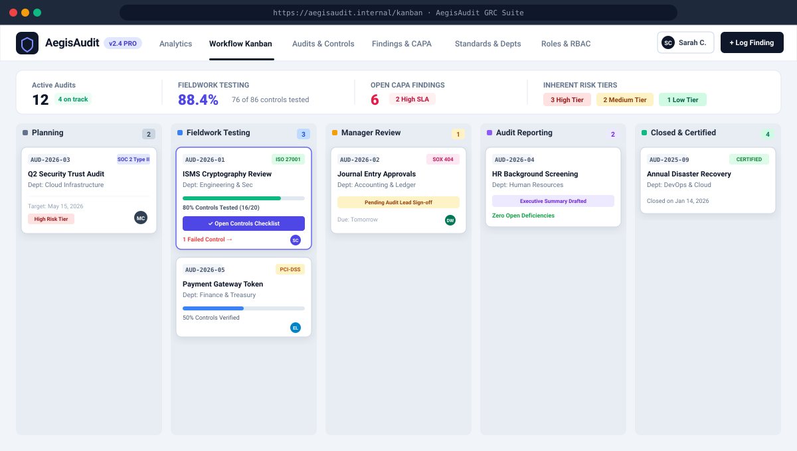

# AegisAudit — Enterprise Internal Audit & Risk Control Matrix (RCM) Platform

A modern, high-assurance internal audit management system built with **React 18, TypeScript, Vite, Tailwind CSS, Express, and an embedded WebAssembly SQLite database**.

Designed for enterprise audit teams, compliance officers, and risk committees to streamline **audit workflows, fieldwork testing, non-compliance findings (CAPA), regulatory framework mapping, and department inherent risk scoring**.

---

## Screenshots & Visual Walkthrough

### 1. Interactive Workflow Kanban Board
Drag-and-drop audit lifecycle management across **Planning**, **Fieldwork Testing**, **Manager Review**, **Draft Reporting**, and **Certified Closed** stages with real-time SLA badges and progress tracking.



---

### 2. Department Inherent Risk Working Paper & Risk Control Matrix (RCM)
Dedicated working paper modal per Department / Business Unit with automated Inherent Risk Tier calculation ($0.6 \times \text{Avg} + 0.4 \times \text{Max}$), 5×5 Likelihood vs. Impact scoring, and multi-control tracking.


---

## Key Capabilities & Features

### 1. Department & Business Unit Inherent Risk Tiers
- **Direct Working Paper Linkage**: Each Department / Business Unit is linked to its own **Inherent Risk Working Paper**.
- **Multi-Item Risk Control Matrix (RCM)**: Users can define and manage multiple RCM rows per department.
- **Automated Risk Scoring & Tiering**:
  $$\text{Department Inherent Score} = (0.6 \times \text{Avg Score}) + (0.4 \times \text{Max Score})$$
  - **$\ge 15.0$** $\rightarrow$ **High Risk Tier** (Flashing red badge & warning indicator)
  - **$9.0 - 14.9$** $\rightarrow$ **Medium Risk Tier** (Amber badge)
  - **$< 9.0$** $\rightarrow$ **Low Risk Tier** (Emerald badge)
- **Granular Matrix Fields**: Process, Sub-Process, Threat & Root Cause, Risk Description, Risk Category, Inherent Likelihood (1–5), Inherent Impact (1–5), Control Code, Control Name & Description, Control Type (*Preventive, Detective, Corrective*), Method (*Automated, Manual, IT-Dependent*), Frequency, Owner, and Control Effectiveness.
- **Export & Duplication**: Quick row cloning, preset audit templates, CSV export, and clean printable working paper format.

### 2. Drag-and-Drop Workflow Kanban
- Visual stage progression with `@hello-pangea/dnd` / native HTML5 drag-and-drop.
- Real-time controls testing progress bars and failed control alerts.
- SLA countdown clocks with automated escalations.

### 3. Standards & Regulatory Framework Management
- Manage regulatory and compliance standards:
  - **ISO 27001:2022** (ISMS Security Controls)
  - **SOC 2 Type II** (AICPA Trust Services Criteria)
  - **SOX 404** (Internal Controls Over Financial Reporting)
  - **NIST CSF 2.0** (Identify, Protect, Detect, Respond, Recover)
  - **PCI-DSS v4.0** (Cardholder Data Environment Security)
  - **GDPR / Privacy** (Articles 25, 30, 32 Data Protection)
- Add, edit, activate/deactivate frameworks with audit associations.

### 4. Fieldwork Controls Testing & Checklist
- Interactive audit execution modal with immediate pass/fail/partial toggles.
- Auditor observation notes with automated timestamp and auditor attribution.
- One-click non-compliance finding creation directly linked to failed controls.
- Instant cross-reference button to open the Department's Inherent Risk Working Paper.

### 5. Findings & Corrective Action Plan (CAPA)
- Root cause analysis and severity classifications (*Critical, High, Medium, Low*).
- Remediation evidence uploads and SLA tracking with overdue alerts.
- Four-eyes sign-off workflow (*Drafted $\rightarrow$ Submitted $\rightarrow$ Under Review $\rightarrow$ Closed*).

### 6. Role-Based Access Control (RBAC) & User Management
- Pre-configured roles with granular permissions:
  - **Chief Audit Executive (CAE) / Admin**: Full audit, user, framework, and policy governance.
  - **Lead Internal Auditor**: Create audits, manage RCM working papers, sign off findings.
  - **Fieldwork Auditor**: Execute controls testing, record observations, log findings.
  - **Auditee / Department Head**: Submit CAPA remediation evidence, view department RCM.
  - **Audit Committee / Viewer**: Read-only oversight and executive reporting.
- Switchable persona bar in the header for testing workflows across different organizational roles.

### 7. Full SQLite Persistence (WebAssembly / SQL.js)
- Server-side SQLite database with WAL and file sync.
- Tables for `users`, `roles`, `frameworks`, `departments`, `risk_control_matrix`, `audits`, `controls`, and `findings`.
- Client and server fallbacks to ensure continuous offline and dev availability.

---

## Default User Accounts (RBAC)

Use these accounts to test the platform or switch seamlessly via the **Persona Switcher** in the top navigation bar:

| Name | Role | Email | Password | Permissions Scope |
| :--- | :--- | :--- | :--- | :--- |
| **Sarah Chen** | Lead Internal Auditor | `sarah.chen@aegis.internal` | `audit2026` | Full audit fieldwork, RCM editing, findings management |
| **Marcus Vance** | Chief Audit Executive (CAE) | `marcus.vance@aegis.internal` | `admin2026` | Global admin, user management, frameworks, role editor |
| **Elena Rostova** | Fieldwork Auditor | `elena.rostova@aegis.internal` | `audit2026` | Controls testing, evidence collection, finding logging |
| **David Wright** | Auditee (Finance Lead) | `david.wright@aegis.internal` | `auditee2026` | Auditee view, remediation evidence upload |
| **Rachel Adams** | Audit Committee Member | `rachel.adams@aegis.internal` | `viewer2026` | Read-only executive dashboards and reports |

---

## Technology Stack

| Layer | Technologies |
| :--- | :--- |
| **Frontend Framework** | React 18, TypeScript, Vite 8 |
| **Styling & Design** | Tailwind CSS 4, Lucide React Icons |
| **Database & ORM** | SQLite 3 (sql.js / wasm), Express backend |
| **Drag & Drop** | `@hello-pangea/dnd` & HTML5 Drag and Drop API |
| **Data Export** | Client-side CSV generator, print media styles |

---

## API Endpoints Reference

### Department & Risk Control Matrix (RCM)
- `GET /api/departments` — List departments with audit counts, RCM count, and auto-calculated inherent risk score.
- `POST /api/departments` — Create a new department or business unit.
- `PUT /api/departments/:id` — Update department details.
- `DELETE /api/departments/:id` — Remove department and associated RCM records.
- `GET /api/rcm` — Fetch all Risk Control Matrix entries (filterable by `?departmentId=...` or `?departmentName=...`).
- `POST /api/rcm` — Create a new RCM entry and **automatically recalculate** the department's Inherent Risk Tier.
- `PUT /api/rcm/:id` — Update an RCM entry and recalculate department Inherent Risk Tier.
- `DELETE /api/rcm/:id` — Delete an RCM entry and recalculate department Inherent Risk Tier.

### Regulatory Frameworks
- `GET /api/frameworks` — List all standards / frameworks.
- `POST /api/frameworks` — Create a new compliance standard.
- `PUT /api/frameworks/:id` — Update framework status and metadata.
- `DELETE /api/frameworks/:id` — Remove framework.

### User & Role Management
- `GET /api/users` — Fetch all system users.
- `POST /api/users` — Create user with assigned RBAC role and department.
- `PUT /api/users/:id` — Update user profile and status.
- `GET /api/roles` — Retrieve role definitions and permission matrices.
- `PUT /api/roles/:id` — Customize granular permissions for a role.

---

## Getting Started

### 1. Install Dependencies
```bash
npm install
```

### 2. Start the Development Server
```bash
npm run dev
```
The application will launch on `http://localhost:3000`.

### 3. Build for Production
```bash
npm run build
npm start
```
